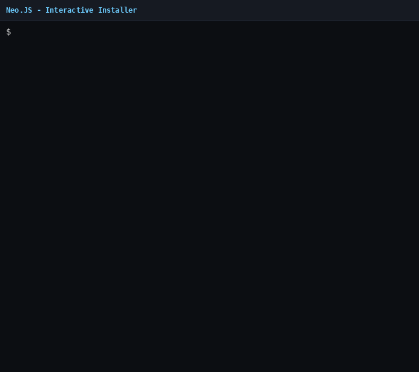
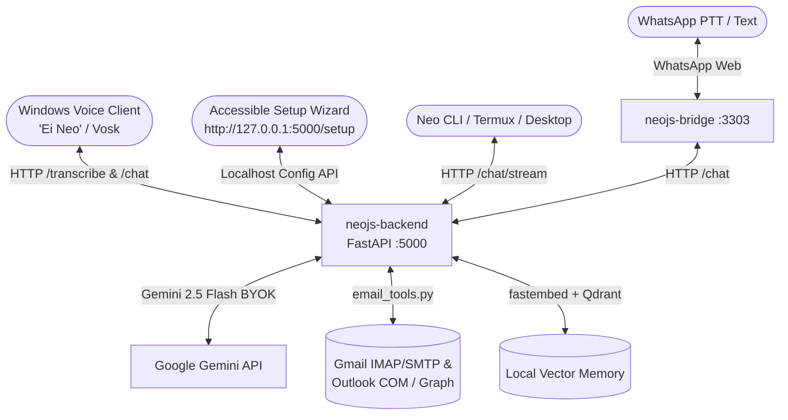

# Neo.JS — Autonomous Voice & Developer Personal Assistant 🚀🎙️♿


**Neo** is a local, **100% BYOK (Bring Your Own Key)** personal AI assistant powered by **Gemini 2.5 Flash**. It runs in two configurable profiles:

- **♿ Voice Accessibility Assistant (`NEO_PROFILE=assistant` — Windows 10/11):** Built for low-vision and hands-free users. Activate by saying **"Ei Neo"**, manage **Gmail & Outlook** by voice in natural Portuguese (`pt-BR`), hear responses with **Microsoft Edge neural voices**, interrupt anytime with `Esc`, and configure everything through a high-contrast visual Setup Wizard (`/setup`).
- **💻 Developer Backpocket Agent (`NEO_PROFILE=dev` — Linux, macOS, Windows):** Connects WhatsApp, the terminal (`neo-cli.py` / Termux + Tailscale), or the Linux Desktop tray app (`Go + Wails`) directly to your OS shell and code projects.

| App / Tray Avatar | Full Body |
|:---:|:---:|
|  |  |

---

## 🪟 Windows 1-Click Install (Voice Assistant `.exe` — No Terminal Required)

[](https://github.com/marcellopato/neo-js/releases/latest/download/Neo-Assistente-Setup.exe)

> Direct link: **[`Neo-Assistente-Setup.exe` (Latest Release)](https://github.com/marcellopato/neo-js/releases/latest/download/Neo-Assistente-Setup.exe)** · [All Releases](https://github.com/marcellopato/neo-js/releases)

### 🇧🇷 Passo a passo rápido (Windows para leigos)
1. **Baixe o instalador:** clique em **[Baixar `Neo-Assistente-Setup.exe`](https://github.com/marcellopato/neo-js/releases/latest/download/Neo-Assistente-Setup.exe)**.
2. **Execute:** dê duplo clique em `Neo-Assistente-Setup.exe` (se o Windows exibir aviso do SmartScreen, clique em **Mais informações** → **Executar assim mesmo**) e avance até **Instalar**.
   - Já inclui Python, bibliotecas de voz/e-mail e o modelo offline `"Ei Neo"` (~31 MB) — não precisa instalar mais nada.
3. **Configure na janela de alto contraste que abrirá sozinha (`http://127.0.0.1:5000/setup`):**
   - **Passo 1 (Chave Gemini gratuita):** clique no botão para abrir o [Google AI Studio](https://aistudio.google.com/apikey), cole sua chave (`AIza...`) e clique em **Testar conexão**.
   - **Passo 2 (Gmail e Outlook):** clique em **+ Usar Outlook do Windows automaticamente** (para Outlook Clássico instalado) e/ou adicione seu **Gmail** (usando uma [Senha de App do Google](https://myaccount.google.com/apppasswords)) e clique em **Testar e-mail**.
   - **Passo 3 (Voz):** clique em **Ouvir a voz do Neo** para testar o áudio.
   - **Passo 4:** clique em **Salvar e Ativar Neo Assistente**.
4. **Como usar no dia a dia:**
   - O Neo inicia sozinho junto com o Windows.
   - Diga **"Ei Neo"**, aguarde o bip sonoro e fale naturalmente (ex.: *"Lê meus e-mails novos"*, *"Procura um e-mail da Porto Seguro"*).
   - Quando o Neo fizer uma pergunta, o microfone **reabre automaticamente por ~8 segundos** para você responder sem precisar repetir *"Ei Neo"*.
   - Aperte **`Esc`** a qualquer momento para interromper a fala imediatamente.
   - Para reabrir a tela de configuração, basta clicar no atalho **Neo Assistente por Voz** na Área de Trabalho.

---

## 💻 Developer Install (Linux, macOS & Windows Source)

```bash
git clone https://github.com/marcellopato/neo-js.git && cd neo-js && node install.js
```

The interactive wizard configures `.env`, sets up the Python `venv`, optionally installs the `systemd` service on Linux, and creates the global **`neo`** terminal command.



<details>
<summary>📋 Manual startup & Windows source script (<code>Instalar-Neo.bat</code>)</summary>

- **Linux / macOS:**
  ```bash
  cp .env.example .env   # Add your GEMINI_API_KEY
  chmod +x start.sh && ./start.sh
  ```
- **Windows (from source ZIP without `.exe`):**
  Extract the repository ZIP and double-click **`Instalar-Neo.bat`** in the root folder *(do not double-click `install.js` in Windows Explorer)*.

</details>

---

## 🏗️ Architecture & Services



| Component | File | Technology | Role |
|---|---|---|---|
| **Cognitive Backend** | `agent.py` | Python + FastAPI + Gemini 2.5 Flash | Tool-calling agent (`dev` & `assistant` profiles) + `/setup` wizard |
| **Neural TTS** | `tts_engine.py` | `edge-tts` (`pt-BR-FranciscaNeural`) + `gTTS` fallback | High-quality PT-BR speech synthesis with markdown/emoji stripping |
| **Multi-Email Tools** | `email_tools.py` | `imaplib`/`smtplib`, `pywin32` COM, MS Graph | Conversational Gmail & Outlook tools with mandatory send confirmation |
| **Hands-Free Voice** | `voice_listener.py` | `Vosk` offline wake word + `sounddevice` + `pygame` | `"Ei Neo"` listener, audio cues, follow-up window, `Esc` interrupt |
| **Windows Bundle** | `neo_windows_app.py` | PyInstaller + Inno Setup (`installer/neo-assistente.iss`) | Self-contained Windows `.exe` launcher |
| **WhatsApp Bridge** | `bridge.js` | Node.js + `whatsapp-web.js` (`:3303`) | Self-chat text & voice (PTT) bridge with auto-healing |
| **Terminal CLI** | `neo-cli.py` | Python + SSE streaming + Termux API | Local or remote SSH/Termux chat client |
| **Desktop Tray** | `daemon/` | Go + Wails + systray | Native Linux/Zorin OS tray & hotkey app |

---

## 🧠 Cost Efficiency & RAG Memory

- **100% BYOK & Free Software:** Runs directly on your own `GEMINI_API_KEY` (~$0.004 per full autonomous cycle on Gemini 2.5 Flash, or free tier via [Google AI Studio](https://aistudio.google.com/apikey)).
- **Local Semantic RAG (`memory.py`):** Embeds conversation turns locally with `fastembed` (`BAAI/bge-small-en-v1.5`) into an embedded `./qdrant_data` store — retrieving only the top-3 relevant past turns per message instead of sending the entire history.
- **Safety Boundaries:**
  - In `NEO_PROFILE=assistant`, shell execution (`run_command`) and arbitrary file writes (`edit_file`) are disabled (`INV-1`).
  - `send_email` enforces explicit user confirmation (`confirmed=True`) before transmitting (`INV-2`).
  - `/setup` binds strictly to `127.0.0.1` and masks all stored secrets (`INV-3`).

---

## 📱 Neo CLI, Termux & Remote Access (Tailscale)

Run `neo` (or `./venv/bin/python neo-cli.py`) to chat from any terminal with truecolor streaming and `/help`, `/status`, `/reset`, `/voz`, `/audio`, and `/copiar` commands.

<details>
<summary>🌍 Using Neo from your phone via Termux + Tailscale (No WhatsApp needed)</summary>

1. Install **Tailscale** on the Neo host (`sudo tailscale up`) and on your Android phone (from Play Store / F-Droid, same account).
2. In **Termux**:
   ```bash
   pkg install python openssh termux-api
   ssh user@machine-name
   neo
   ```
   The backend remains safely bound to `127.0.0.1:5000` while Termux gives you mobile voice (`termux-tts-speak`, `termux-microphone-record`) and push approval buttons (`termux-notification`).

</details>

---

## 🔑 Environment Variables (`.env`)

| Variable | Default | Description |
|---|---|---|
| `GEMINI_API_KEY` | *(required)* | Your Google AI Studio / Cloud Gemini API key (BYOK) |
| `INTERNAL_API_KEY` | *(auto-generated)* | Internal auth secret (`X-Neo-Token` header) |
| `NEO_PROFILE` | `dev` (`assistant` on Windows `.exe`) | `dev` (coding/shell tools) or `assistant` (voice-first, email, no shell) |
| `NEO_VOICE_ENABLED` | `true` | Enables TTS audio replies |
| `NEO_TTS_VOICE` | `pt-BR-FranciscaNeural` | Microsoft Edge neural voice (`pt-BR-FranciscaNeural`, `pt-BR-AntonioNeural`) |
| `NEO_TTS_RATE` | `+0%` | Speech rate adjustment (e.g. `+10%`, `-5%`) |
| `NEO_FOLLOWUP_SECONDS` | `8` | Seconds microphone stays open for follow-up replies after Neo speaks |
| `NEO_PASSWORD` | *(optional)* | Unlock password for WhatsApp `dormir` / `lock` command |
| `GROK_API_KEY` | *(optional)* | Fallback xAI Grok key if Gemini quota is exhausted |

---

## 📐 Spec-Driven Development (SDD)

Neo.JS uses [**sdd-agentic-flow**](https://github.com/gmartins-dev/sdd-agentic-flow) with specifications under [`.specs/features/voice-accessibility-assistant/`](.specs/features/voice-accessibility-assistant/spec.md). Run tests with:

```bash
./venv/bin/python -m unittest discover -s test -p "test_*.py" -v
npm test
```

---

## 🤝 Contributors

- **Marcello Pato** — Creator and lead developer.
- **Community** — Issues and Pull Requests are welcome!
